# 数学分析答疑小程序

一个面向大学《数学分析》课程的三端一体项目：

- **学生端微信小程序**：向 DeepSeek 提问、查看历史提问与教师评论、在同学圈评论/给评论点赞、浏览学习资源。
- **Node.js 后端**：代理 DeepSeek API、保存问答/评论/评论点赞、教师邮箱账号与会话、资源上传/下载、服务号评论通知。
- **教师 Web 后台**：邮箱注册登录、修改账号/对外展示 ID/密码；查看问题并在详情中评论、给评论点赞；导出 **Markdown** 与 **Word（.docx）**；上传和维护 PPT / Word / PDF 教学资源。
- **TencentDB for MySQL**：线上保存学生匿名身份、问答、点赞和备份记录。
- **腾讯云 COS**：每日自动备份与教师后台手动备份，支持空库恢复。
- **微信云托管 CloudBase Run**：现有 Express 打包为容器；快速接口走 `wx.cloud.callContainer` 私网，DeepSeek 长问答和资源下载走云托管公网 HTTPS（`callContainer` 最大 15 秒）。

DeepSeek API Key 只保存在服务端，不会进入小程序包，也不会发送到学生设备。

> 本地没有数据库时可以使用 JSON 模式快速演示；线上请按 [腾讯云部署指南](docs/DEPLOY_TENCENT_CLOUD.md) 或 [微信云托管部署指南](docs/DEPLOY_WECHAT_CLOUD_RUN.md) 切换为 MySQL + COS。
>
> 如果项目根目录下还出现一个同名 `math-analysis-tutor/` 子文件夹，那通常是以前解压 ZIP 留下的副本；使用外层目录（同时包含 `server`、`miniprogram`、`Dockerfile` 的那层），不要把旧副本导入开发者工具。

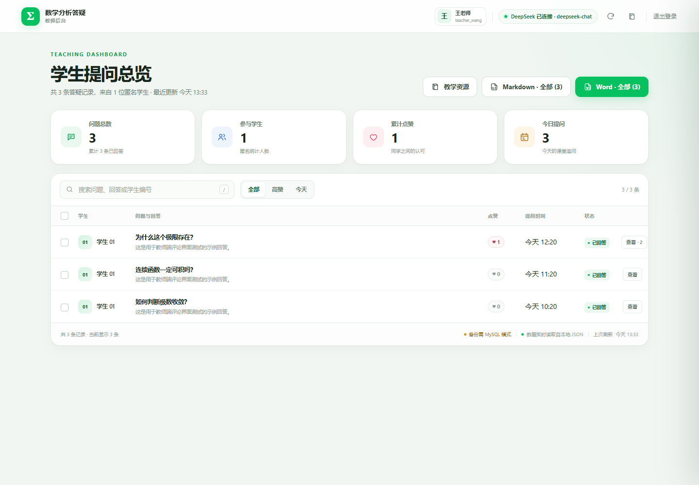

---

## 功能对照

| 需求 | 实现 |
| --- | --- |
| 微信风格界面，底部四列图标 | 自定义 TabBar：答疑 / 我的 / 同学圈 / 资源，书本造型图标 |
| 第一列对话界面，左侧白色 AI 气泡，右侧学生绿色气泡 | 聊天气泡、头像、时间、长按复制、错误重试、连续追问上下文 |
| 答疑支持图片输入 | 相册/拍照选择一张题目图片，可配文字或不配文字发送，调用 DeepSeek 视觉模型；历史提问和同学圈可回看 |
| 第二列学生历史问题，逐行展示，可跳转 | 我的提问列表、分页加载、下拉刷新；点击带入对话页继续追问 |
| 第三列全体学生提问，匿名排列，前三个高赞，其余按时间 | 匿名同学编号、Top 3 高赞卡片、最新提问、点赞（每人每题一次） |
| 第四列学习资源 | 书本图标 Tab；学生按讲义/课件/作业题/答案/练习题/模拟试卷浏览并打开 |
| 教师上传和修改教学资源 | 教师后台「教学资源」页：上传、编辑标题/分类/简介、替换文件、删除；支持 PPT/Word/PDF |
| 教师邮箱账号 | 注册、邮箱登录、修改教师名称/对外展示 ID/登录邮箱、修改密码；旧教师口令仍可应急登录 |
| 教师评论与评论点赞 | 教师后台「查看」弹窗内发表评论、给学生评论点赞；教师评论在同学圈置顶 |
| 同学圈评论区 | 每个匿名问题可展开评论区，学生和教师都能评论、给评论点赞 |
| 历史教师评论 | 「我的」列表直接展示每个历史问题的教师评论，教师名称后带灰色“教师评论” |
| 服务号推送 | 教师发表评论后，已绑定小程序 openid 且关注服务号的学生收到模板消息（需配置） |
| 教师端导出全部问题 | 教师登录后查看全部记录，导出 Markdown 与 Word；支持全量、筛选结果或勾选导出 |
| 后端接入 DeepSeek API | `POST /api/questions` 内部调用 DeepSeek Chat Completions，服务端保存回答 |
| 线上数据保存 | MySQL 8 存储学生哈希身份、问答、点赞、教师账号、评论和推送记录；JSON 仅作为本地演示模式 |
| 数据备份 | COS 每日自动备份 + 教师后台手动备份；支持恢复到空数据库 |

### 界面预览

> 以下为小程序 WXML/WXSS 模板渲染预览；最终效果以微信开发者工具和真机为准。

| 对话首页 | 对话中 | 我的提问 | 同学圈 |
| --- | --- | --- | --- |
| 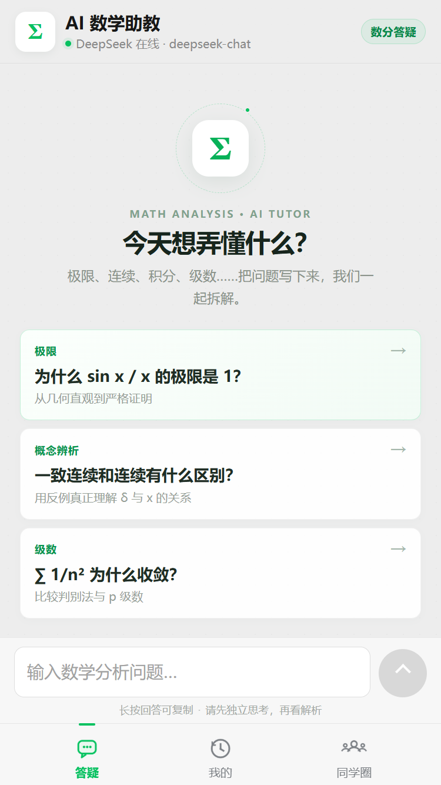 | 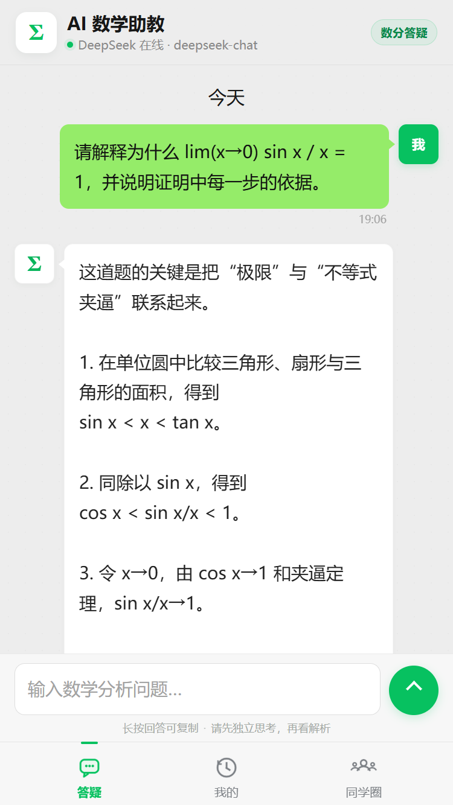 | 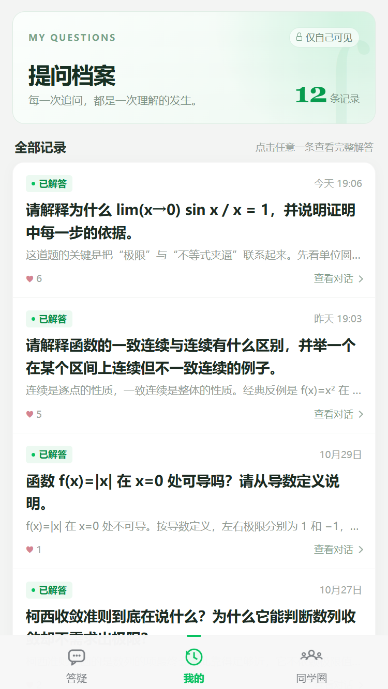 | 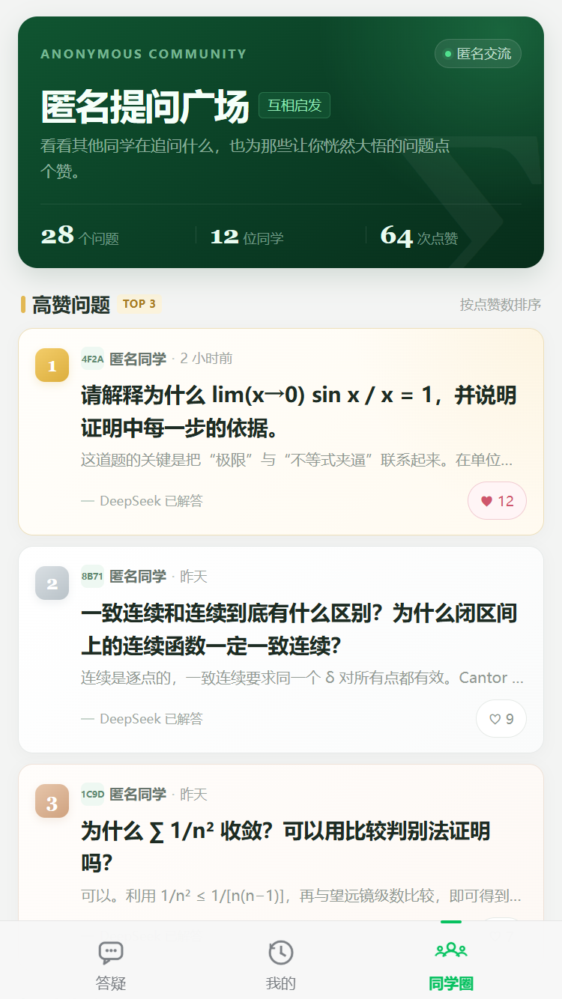 |

| 学习资源（第四列） | 同学圈评论区 |
| --- | --- |
| 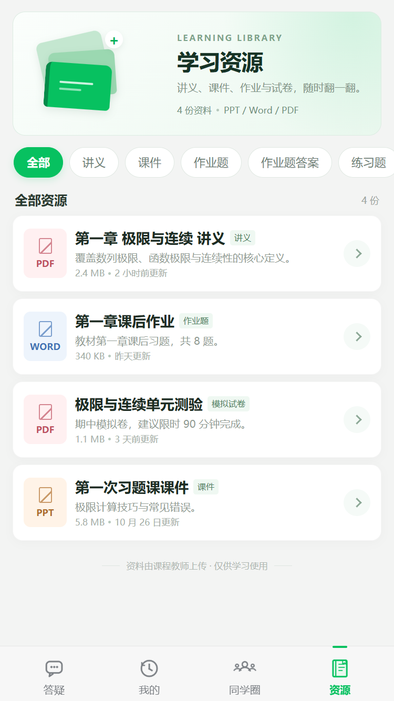 | 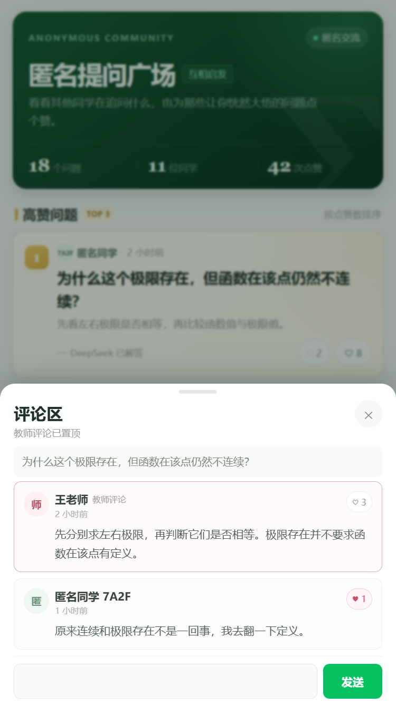 |

| 我的提问里的教师评论 |
| --- |
| 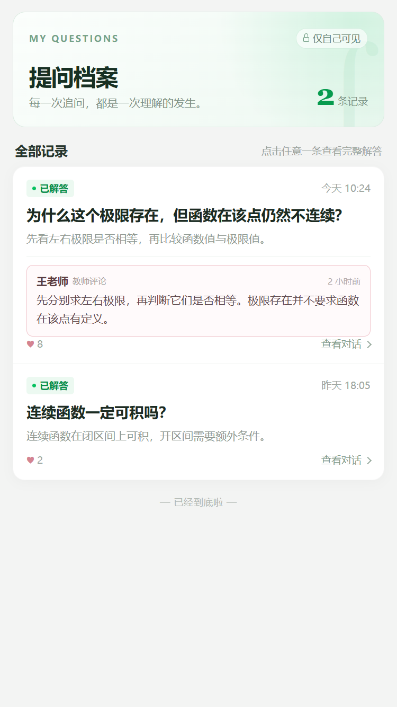 |

教师端（截图中为演示数据）：

| 登录 | 问题详情与评论 | 教学资源管理 |
| --- | --- | --- |
| 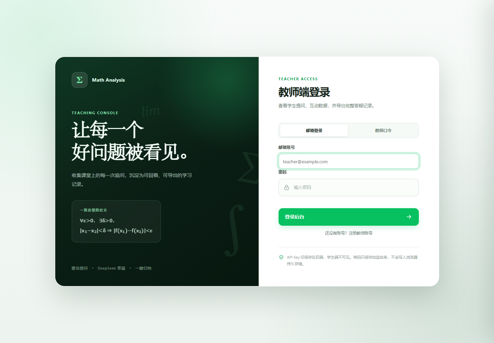 | 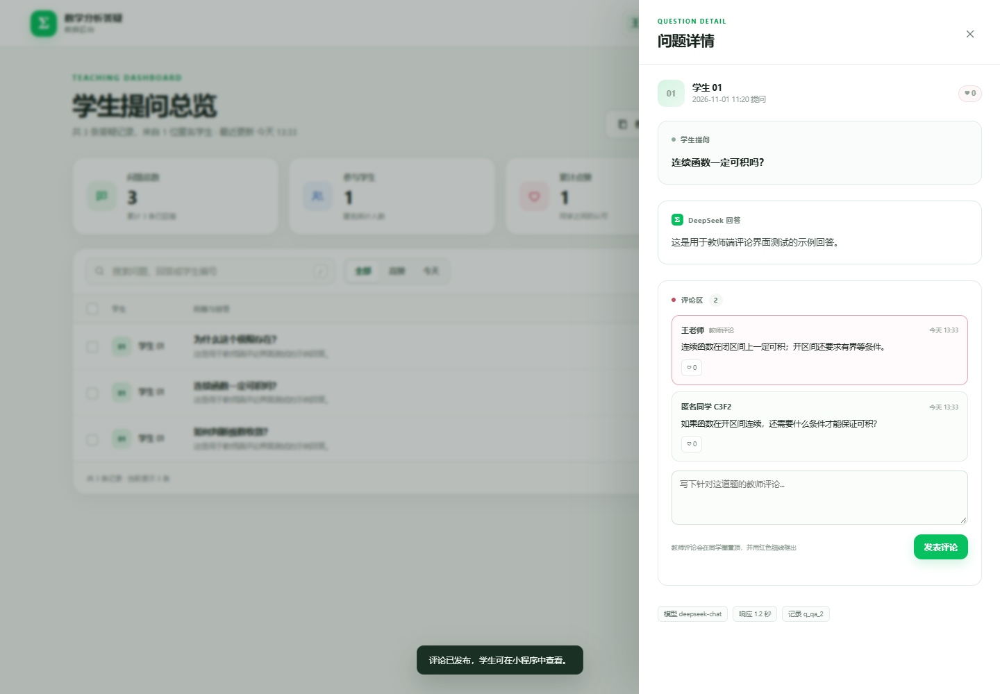 | 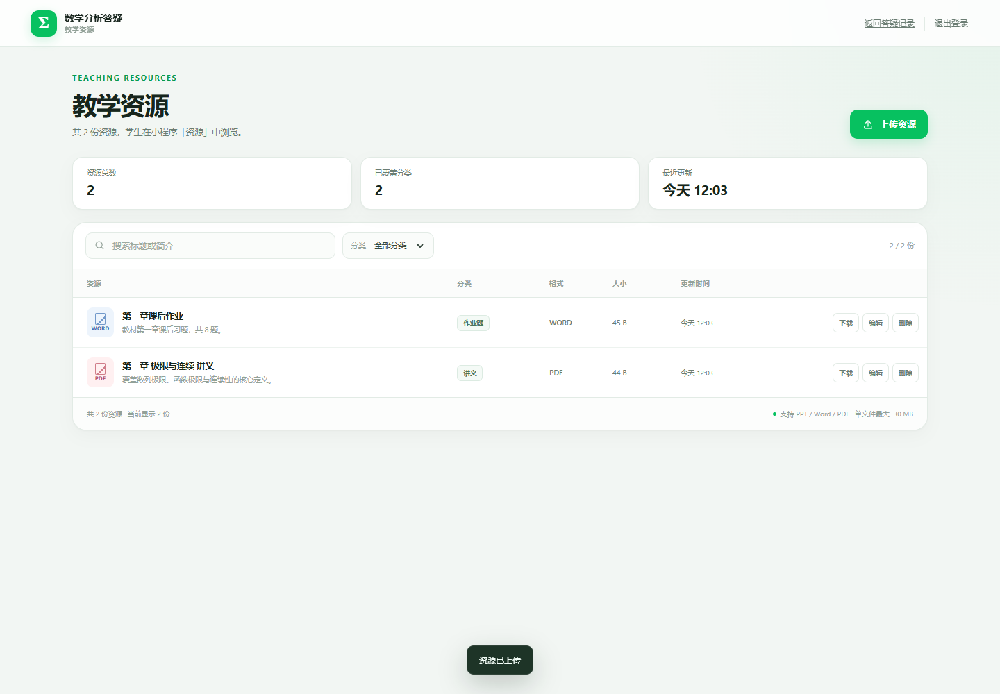 |

---

## 项目结构

```text
math-analysis-tutor/
├─ miniprogram/                 # 微信小程序
│  ├─ pages/chat/               # 对话页
│  ├─ pages/history/            # 我的提问
│  ├─ pages/community/          # 匿名同学圈 + 点赞 + 评论区
│  ├─ pages/resources/          # 第四列：学习资源
│  ├─ custom-tab-bar/           # 自定义底部四栏
│  ├─ utils/api.js              # wx.request / callContainer 封装
│  ├─ utils/client.js           # 本机匿名身份
│  ├─ utils/format.js           # 时间/摘要格式化
│  ├─ config.js                 # 后端地址（需要按环境修改）
│  └─ assets/tabbar/            # 图标 PNG
├─ server/                      # Express 后端
│  ├─ src/app.js                # API 路由与安全中间件
│  ├─ src/server.js             # 启动入口
│  ├─ src/db/schema.js          # MySQL 表结构与版本
│  ├─ src/lib/deepseek.js       # DeepSeek 客户端与系统提示词
│  ├─ src/lib/mysql-store.js    # MySQL 存储层
│  ├─ src/lib/store.js          # JSON 本地演示存储
│  ├─ src/lib/store-factory.js  # 根据 DB_DRIVER 选择存储
│  ├─ src/lib/backup.js         # COS / 本地备份与定时任务
│  ├─ src/lib/resource-storage.js # 资源文件 COS/本地存储
│  ├─ src/lib/resource-service.js # 资源上传、修改、下载、类型校验
│  ├─ src/lib/question-image-service.js # 答疑图片校验/存储/读取
│  ├─ src/lib/auth.js           # 密码哈希、会话 token、评论校验
│  ├─ src/lib/teacher-service.js # 教师注册/登录/资料/密码修改
│  ├─ src/lib/wechat-push.js    # 服务号统一服务消息推送
│  ├─ src/lib/exporter.js       # Markdown / Word 导出
│  ├─ scripts/                  # migrate / import / backup / restore
│  ├─ public/                   # 教师后台 + 教学资源管理页
│  ├─ test/                     # 后端集成测试
│  ├─ .env                      # 本机密钥配置（已被 gitignore）
│  └─ .env.example              # 配置模板（MySQL + COS）
├─ deploy/                      # Nginx、systemd、COS 生命周期示例
├─ docs/                        # 界面截图、腾讯云/微信云托管部署指南
├─ tools/                       # 图标生成、小程序静态校验
├─ Dockerfile                    # 微信云托管 / CloudBase Run 镜像
├─ .dockerignore                 # 防止 .env、数据、Key 进入镜像
├─ project.config.json          # 微信开发者工具项目配置
├─ start-teacher.bat            # Windows 一键启动教师端
└─ README.md
```

---

## 快速开始

### 环境要求

- Node.js **20 或以上**（推荐 22/24）
- 微信开发者工具
- 一个 DeepSeek 开放平台 API Key

### 1. 配置 DeepSeek Key

编辑 `server/.env`：

```dotenv
DEEPSEEK_API_KEY=sk-你的密钥
```

教师账号相关配置也在 `.env`：

```dotenv
ADMIN_TOKEN=旧教师口令，同时作为注册码兜底
# 可选：单独设置教师注册码；不填则使用 ADMIN_TOKEN
TEACHER_REGISTER_CODE=
```

教师端现在默认使用邮箱注册/登录。打开 `/admin` 后可以：

- 用邮箱 + 密码登录；
- 点「注册教师账号」，注册码填 `TEACHER_REGISTER_CODE`，未设置时填 `ADMIN_TOKEN`；
- 登录后点击右上角教师头像修改教师名称、对外展示 ID、登录邮箱和密码；
- 旧「教师口令」登录仍保留，但不能修改资料和密码。

> 本机 `.env` 已随机生成教师口令和哈希盐值，且可能已填入真实 DeepSeek Key；不要提交 `.env`，不要把它发给学生。
> **ZIP 分发包不包含 `.env`**。服务器部署时复制 `.env.example` 为 `.env` 并重新填写；服务端也会在缺少密钥时打印临时教师口令。

### 2. 启动后端

Windows 可直接双击：

```text
start-teacher.bat
```

或在命令行运行：

```bash
cd server
npm install
npm start
```

启动后：

- 教师后台：<http://127.0.0.1:3000/admin>
- 健康检查：<http://127.0.0.1:3000/api/health>
- 局域网访问：控制台会打印形如 `http://192.168.x.x:3000` 的地址

首次启动若依赖未安装，`start-teacher.bat` 会自动执行安装。

> 本地默认是 `DB_DRIVER=json`，无需安装数据库即可预览。JSON 文件只用于开发/演示，不支持多实例和自动备份。

### 3. 切换到线上 MySQL + COS

在 `server/.env` 中设置：

```dotenv
DB_DRIVER=mysql
MYSQL_HOST=腾讯云数据库内网地址
MYSQL_PORT=3306
MYSQL_USER=math_tutor
MYSQL_PASSWORD=强密码
MYSQL_DATABASE=math_tutor

BACKUP_ENABLED=true
COS_SECRET_ID=...
COS_SECRET_KEY=...
COS_BUCKET=math-tutor-backup-1250000000
COS_REGION=ap-guangzhou
COS_BACKUP_PREFIX=math-analysis-tutor/backups

RESOURCE_STORAGE=cos
COS_RESOURCE_PREFIX=math-analysis-tutor/resources
RESOURCE_MAX_SIZE_MB=30
```

然后执行：

```bash
cd server
npm ci --omit=dev
npm run db:migrate
npm start
```

已有 JSON 数据可一次性导入：

```bash
npm run db:import-json -- --file ./data/questions.json
```

两种线上部署方式：

- **微信云托管（当前方案 A）**：现有 Express 容器化；小程序快速接口走私网，长问答/资源下载与教师后台走 HTTPS 公网域名  
  **[微信云托管部署指南](docs/DEPLOY_WECHAT_CLOUD_RUN.md)**
- **腾讯云轻量服务器 + Nginx**：传统服务器部署  
  **[腾讯云部署指南](docs/DEPLOY_TENCENT_CLOUD.md)**

### 4. 打开小程序

1. 用微信开发者工具导入本项目**根目录** `math-analysis-tutor/`。
2. 确认 `project.config.json` 的 `appid` 是你自己的小程序 AppID（真机预览和服务号推送都需要真实 AppID）。
3. 确认 [miniprogram/config.js](miniprogram/config.js)：
   - 本地 HTTP 模式：

   ```js
   transport: 'http',
   apiBaseUrl: 'http://127.0.0.1:3000',
   ```

   - 微信云托管模式：

   ```js
   transport: 'cloud',
   cloudEnv: 'prod-xxxxxx',
   cloudService: 'math-tutor',
   cloudPublicBaseUrl: 'https://math-tutor-xxxxxx.ap-shanghai.app.tcloudbase.com',
   ```

4. 本地 HTTP 模式需在开发者工具「详情 → 本地设置」勾选：
   - **不校验合法域名、web-view（业务域名）、TLS 版本以及 HTTPS 证书**
5. 编译。首次进入会生成本机匿名身份；提问需要后端已配置有效的 DeepSeek Key。

> 微信云托管模式：快速接口通过 `wx.cloud.callContainer` 调用，前提是当前小程序已经关联目标云开发环境。由于 `callContainer` 单次请求最长只有 15 秒，DeepSeek 问答、图片上传和资源下载使用 `cloudPublicBaseUrl`，必须把该 HTTPS 域名加入 **request + downloadFile + uploadFile 合法域名**。

> **真机调试注意**：微信真机默认不允许请求 HTTP 和未备案域名。可选方案：
> 1. 开发阶段：使用开发者工具「真机调试」并打开不校验域名；手机与电脑同一 Wi-Fi，电脑防火墙放行 3000 端口。
> 2. 正式使用：给后端配置 HTTPS 域名，并在小程序后台「开发管理 → 服务器域名」把该域名加入 **request 合法域名**；学生打开教学资源/图片还需要加入 **downloadFile 合法域名**，图片提问还需要 **uploadFile 合法域名**。

---

## 配置项

配置文件：`server/.env`

| 变量 | 默认值 | 说明 |
| --- | --- | --- |
| `PORT` | `3000` | 后端端口 |
| `HOST` | `0.0.0.0` | 监听地址；只用本机可改 `127.0.0.1` |
| `DEEPSEEK_API_KEY` | 空 | **必填**，DeepSeek API Key |
| `DEEPSEEK_BASE_URL` | `https://api.deepseek.com` | 官方地址；代理/网关可改 |
| `DEEPSEEK_MODEL` | `deepseek-chat` | 纯文字提问模型，可改为 `deepseek-reasoner` |
| `DEEPSEEK_VISION_MODEL` | `deepseek-flash` | 图片提问的视觉模型 |
| `DEEPSEEK_TIMEOUT_MS` | `60000` | 上游超时，最大 120000 |
| `ADMIN_TOKEN` | 随机生成 | 旧教师口令 / 注册码兜底；建议至少 16 位 |
| `TEACHER_REGISTER_CODE` | 同 `ADMIN_TOKEN` | 邮箱注册教师账号所需的注册码 |
| `COMMENTS_PER_MINUTE` | `20` | 每个学生/教师每分钟评论上限 |
| `CLIENT_HASH_SALT` | 随机生成 | 学生匿名身份哈希盐；**修改后旧记录无法再归属原学生** |
| `DB_DRIVER` | `json` | `mysql`（线上）或 `json`（本地演示） |
| `MYSQL_HOST` | `127.0.0.1` | TencentDB 内网地址 |
| `MYSQL_PORT` | `3306` | MySQL 端口 |
| `MYSQL_USER` | 空 | 数据库业务账号 |
| `MYSQL_PASSWORD` | 空 | 数据库密码 |
| `MYSQL_DATABASE` | 空 | 数据库名，例如 `math_tutor` |
| `MYSQL_CONNECTION_LIMIT` | `10` | 连接池上限 |
| `MYSQL_SSL` | `false` | 公网访问数据库时开启 |
| `DB_AUTO_MIGRATE` | `true` | 启动时自动建表/迁移 |
| `BUSINESS_TIMEZONE_OFFSET_MINUTES` | `480` | 业务时区（中国 UTC+8），影响“今日提问”和备份目录日期 |
| `BACKUP_ENABLED` | `false` | 是否启用定时备份 |
| `COS_SECRET_ID` / `COS_SECRET_KEY` | 空 | COS 子用户密钥，仅存服务器 |
| `COS_BUCKET` / `COS_REGION` | 空 | COS 桶与地域 |
| `COS_BACKUP_PREFIX` | `math-analysis-tutor/backups` | 备份对象前缀 |
| `BACKUP_CRON` | `0 3 * * *` | 自动备份 cron，默认每天 03:00 |
| `BACKUP_TIMEZONE` | `Asia/Shanghai` | cron 时区 |
| `BACKUP_LOCAL_DIR` | 空 | 可选，额外写一份本地备份 |
| `MANUAL_BACKUP_RATE_LIMIT_PER_HOUR` | `10` | 教师手动备份频率上限 |
| `RESOURCE_STORAGE` | `auto` | 教学资源存储：`auto` / `cos` / `local`；云托管应设 `cos` |
| `COS_RESOURCE_PREFIX` | `math-analysis-tutor/resources` | COS 资源文件前缀 |
| `RESOURCE_LOCAL_DIR` | `uploads/resources` | 本地模式资源目录 |
| `RESOURCE_MAX_SIZE_MB` | `30` | 单个教学资源文件大小上限 |
| `QUESTION_IMAGE_LOCAL_DIR` | `uploads/question-images` | 本地模式答疑图片目录 |
| `COS_QUESTION_IMAGE_PREFIX` | `math-analysis-tutor/question-images` | COS 答疑图片前缀 |
| `QUESTION_IMAGE_MAX_SIZE_MB` | `8` | 单张答疑图片大小上限 |
| `WECHAT_PUSH_ENABLED` | `false` | 是否启用教师评论服务号推送 |
| `MINIPROGRAM_APPID` | 空 | 小程序 AppID，用于 `jscode2session` 绑定 openid |
| `MINIPROGRAM_SECRET` | 空 | 小程序 AppSecret，仅存服务端 |
| `WECHAT_MP_APPID` | 空 | 同主体服务号 AppID |
| `WECHAT_MP_TEMPLATE_ID` | 空 | 服务号评论通知模板 ID |
| `WECHAT_MP_TEMPLATE_URL` | `https://weixin.qq.com/` | 服务号模板消息兜底链接 |
| `DATA_DIR` | `data` | JSON 模式数据目录，支持相对/绝对路径 |
| `MAX_QUESTION_LENGTH` | `2000` | 单次问题最大字符数 |
| `MAX_CONTEXT_MESSAGES` | `12` | 带给 DeepSeek 的历史消息上限 |
| `ASK_RATE_LIMIT_PER_MINUTE` | `10` | 每个匿名学生每分钟提问上限 |
| `LIKE_RATE_LIMIT_PER_MINUTE` | `40` | 每个匿名学生每分钟点赞操作上限 |
| `LOGIN_RATE_LIMIT_PER_15_MIN` | `10` | 每个 IP 每 15 分钟教师登录尝试上限 |

修改系统提示词：`server/src/lib/deepseek.js` 顶部的 `SYSTEM_PROMPT`。

### 图片答疑

- 默认使用 DeepSeek 官方视觉模型 `deepseek-flash`，可通过 `DEEPSEEK_VISION_MODEL` 修改；参考 [DeepSeek Vision 文档](https://api-docs.deepseek.com/guides/vision/)。
- 支持 JPEG / PNG / GIF / WebP，单图默认最大 **8 MB**；小程序会优先使用压缩图。
- 图片可以单独发送，也可以配文字；纯图片会使用“请分析这张图片中的数学问题。”作为问题文本。
- 图片文件默认写入 `server/uploads/question-images`；生产设置 `RESOURCE_STORAGE=cos` 时写入 `COS_QUESTION_IMAGE_PREFIX`。
- 图片通过随机 token 的 `/api/images/:token` 只读地址展示；历史提问、同学圈和教师详情都可以回看。
- 云托管/HTTP 真机需要把公网域名同时加入：
  - `request` 合法域名
  - `downloadFile` 合法域名（图片预览）
  - `uploadFile` 合法域名（图片上传）

---

## 教师后台与导出

打开 `/admin`，默认使用邮箱注册/登录；右上角教师头像进入账号设置。旧「教师口令」登录仍保留。

- **注册**：注册码默认使用 `TEACHER_REGISTER_CODE`，未配置时使用 `ADMIN_TOKEN`。
- **账号设置**：修改教师名称、对外展示 ID、登录邮箱（需当前密码）和密码；修改密码会让其他会话失效。
- **数据概览**：问题总数、参与学生数、累计点赞、今日提问。
- **搜索/筛选**：按问题、回答、学生编号搜索；全部 / 高赞 / 今天。
- **查看详情**：点击任意行查看完整问题、完整 DeepSeek 回答、模型和响应耗时。
- **评论**：详情弹窗内发表教师评论，或给已有学生/教师评论点赞；教师评论在同学圈置顶并用红色细线框出。
- **服务号推送**：教师评论后，系统尝试给该问题学生发送服务号模板消息（需配置）。
- **勾选导出**：勾选若干行后，只导出所选记录。
- **未勾选时**：导出当前筛选结果；没有筛选条件时即全部记录。
- **Markdown / Word**：导出文件带统计摘要、匿名学生编号、时间、点赞数、完整问答，按时间正序排列。
- **COS 备份**：右上角云朵按钮可立即备份；页脚显示最近备份时间、失败状态或“未配置”；成功/失败写入 `backup_runs`。
- **教学资源管理**：顶部书本图标进入 `/admin/resources.html`，支持上传、编辑、替换文件和删除；支持 PPT/PPTX/DOC/DOCX/PDF。

导出接口同时支持 GET 和 POST：

```http
GET  /api/admin/export.md?ids=q_xxx,q_yyy
GET  /api/admin/export.docx
POST /api/admin/export.md
POST /api/admin/export.docx
Authorization: Bearer <邮箱登录会话 token 或 ADMIN_TOKEN>
Content-Type: application/json

{ "ids": ["q_xxx", "q_yyy"] }
```

不传 `ids` 即导出全部。

### 教师评论服务号推送

推送不是“有学生账号就自动可用”，需要同时满足：

1. 小程序使用真实 AppID，并配置 `MINIPROGRAM_APPID` / `MINIPROGRAM_SECRET`；
2. 服务号与小程序同主体且已绑定，配置 `WECHAT_MP_APPID`；
3. 服务号后台有评论通知模板，配置 `WECHAT_MP_TEMPLATE_ID`，模板字段使用：
   - `first`：老师评论了你的提问
   - `keyword1`：问题摘要
   - `keyword2`：评论摘要
   - `remark`：点击进入小程序查看完整评论
4. 学生打开过小程序，服务端通过 `wx.login` 的 code 换到小程序 openid；
5. 学生已关注该服务号（微信限制，未关注无法收到公众号模板消息）；
6. `WECHAT_PUSH_ENABLED=true`。

本机/未配置时不会影响评论保存，只跳过推送。通知结果会写入 `push_notifications`，但不会阻塞教师发表评论。

---

## API 一览

公开/学生接口需要请求头 `X-Client-Id: <本机匿名ID>`（小程序会自动带上）；教师接口需要 `Authorization: Bearer <邮箱登录会话 token>` 或旧 `ADMIN_TOKEN`。

| 方法 | 路径 | 说明 |
| --- | --- | --- |
| GET | `/api/health` | 服务/数据库状态、DeepSeek 是否已配置；数据库不可用时返回 503 |
| POST | `/api/questions` | 提问；JSON 纯文字或 multipart（`question` + `image`）图片提问 |
| GET | `/api/images/:token` | 读取答疑图片（随机 token，公开只读） |
| GET | `/api/questions/mine?limit=30&offset=0` | 我的历史提问，含教师评论 |
| GET | `/api/questions/:id` | 单条问答 |
| POST | `/api/questions/:id/like` | 切换点赞（同一匿名身份只能赞一次） |
| GET | `/api/community?limit=30&offset=0` | 高赞 Top 3 + 其余提问分页，含评论数 |
| GET | `/api/questions/:id/comments` | 学生读取评论区（教师评论置顶） |
| POST | `/api/questions/:id/comments` | 学生发表评论 |
| POST | `/api/comments/:id/like` | 学生给评论点赞/取消 |
| POST | `/api/identity/bind` | 用 `wx.login` code 绑定小程序 openid（推送用） |
| POST | `/api/auth/register` | 邮箱注册教师账号 |
| POST | `/api/auth/login` | 邮箱登录 |
| GET | `/api/auth/me` | 当前教师资料 |
| PATCH | `/api/auth/profile` | 修改教师名称/展示 ID/邮箱 |
| POST | `/api/auth/password` | 修改密码并轮换会话 |
| POST | `/api/auth/logout` | 注销会话 |
| GET | `/api/resources?category=` | 学生浏览教学资源 |
| GET | `/api/resources/:id/file` | 学生下载/打开资源文件（需 `X-Client-Id`） |
| POST | `/api/admin/login` | 旧教师口令登录（兼容） |
| GET | `/api/admin/questions` | 教师端全量列表与统计 |
| GET | `/api/admin/questions/:id/comments` | 教师读取评论 |
| POST | `/api/admin/questions/:id/comments` | 教师发表评论 |
| POST | `/api/admin/comments/:id/like` | 教师给评论点赞 |
| GET | `/api/admin/resources` | 教师端资源列表 |
| POST | `/api/admin/resources` | 上传资源（multipart，字段 `file` + 元数据） |
| PATCH | `/api/admin/resources/:id` | 修改资源，可替换文件 |
| DELETE | `/api/admin/resources/:id` | 删除资源 |
| GET | `/api/admin/resources/:id/file` | 教师下载资源 |
| GET | `/api/admin/backup` | 备份配置、最近一次备份与运行状态 |
| POST | `/api/admin/backup` | 立即触发一次 COS/本地备份 |
| GET/POST | `/api/admin/export.md` | 导出 Markdown |
| GET/POST | `/api/admin/export.docx` | 导出 Word |

提问请求示例：

```json
{
  "question": "请解释为什么 lim(x→0) sin x / x = 1。",
  "context": [
    { "role": "user", "content": "上一轮问题" },
    { "role": "assistant", "content": "上一轮回答" }
  ]
}
```

成功响应统一为：

```json
{
  "ok": true,
  "data": {
    "id": "q_xxx",
    "question": "……",
    "answer": "……",
    "createdAt": "2026-10-31T11:00:00.000Z",
    "likeCount": 0,
    "likedByMe": false,
    "status": "answered"
  }
}
```

错误响应：

```json
{
  "ok": false,
  "error": { "code": "DEEPSEEK_NOT_CONFIGURED", "message": "……" },
  "requestId": "…"
}
```

常见错误码：`DEEPSEEK_NOT_CONFIGURED`、`DEEPSEEK_AUTH_ERROR`、`DEEPSEEK_TIMEOUT`、`DEEPSEEK_RATE_LIMITED`、`ASK_RATE_LIMITED`、`ADMIN_UNAUTHORIZED`、`BACKUP_NOT_CONFIGURED`、`BACKUP_IN_PROGRESS`、`BACKUP_RATE_LIMITED`。

---

## 数据、匿名与隐私

### 线上表结构

`npm run db:migrate` 会自动创建：

- `students`：匿名身份哈希、匿名称号、创建/活跃时间、可选小程序 openid（仅用于服务号推送）
- `questions`：问题、DeepSeek 回答、模型、token 用量、耗时
- `likes`：问题 + 学生的联合主键，数据库层保证每人每题只能赞一次
- `teachers`：教师邮箱、scrypt 密码哈希、姓名、对外展示 ID
- `teacher_sessions`：教师登录会话的 token 哈希、过期时间
- `question_comments`：问题评论，区分教师/学生、作者快照与创建时间
- `comment_likes`：评论 + 评论者联合主键，学生和教师都可点赞
- `push_notifications`：教师评论服务号推送状态与错误信息
- `resources`：标题、分类、简介、文件名、格式、大小、COS Key、更新时间
- `backup_runs`：备份状态、COS 对象 Key、文件大小、错误信息
- `schema_migrations`：表结构版本（当前 v4）

删除问题使用 `questions.deleted_at` 软删除；已有查询都会过滤 `deleted_at IS NULL`。

### 匿名身份

- 学生身份 = 小程序本机存储的随机 `clientId`；服务端只保存它的 **加盐 SHA-256 哈希**。
- 不采集微信昵称、头像、手机号；学习身份仍然是本机匿名 `clientId`。
- 为了教师评论推送，服务端会在学生打开小程序时用 `wx.login` code 换取 **小程序 openid** 并关联到匿名身份哈希；openid 不做展示，只用于服务号模板消息。未配置推送时不会绑定。
- 教师端只展示「学生 01 / 学生 02」；同学圈只展示「匿名同学 + 头像编号」。
- 清除小程序缓存/存储或更换手机后，旧记录不再归属到新身份（这是匿名身份的代价）。如果以后需要跨设备历史，应改为完整登录体系。
- 教学资源只允许教师上传；学生按分类浏览，文件通过后端鉴权代理下载，不直接暴露 COS Key。
- 资源文件支持 `.ppt`、`.pptx`、`.doc`、`.docx`、`.pdf`，单文件默认最大 30 MB。
- 问题会发送给 DeepSeek 用于生成回答，请遵守课程与平台的数据使用约定。

### 备份

线上备份由 MySQL 快照导出，不依赖 `mysqldump`：

- 自动：`BACKUP_ENABLED=true` 后按 `BACKUP_CRON` 执行，上传 COS；可选本地副本。
- 手动：教师后台云朵按钮，或 `npm run backup`。
- 恢复：`npm run restore -- <备份文件> --yes`，只允许导入**空数据库**。
- 备份包含教师账号、学生、问题（含答疑图片元数据）、点赞、评论、评论点赞和资源元数据；资源/答疑图片的二进制文件保存在 COS，建议开启版本控制或单独做 COS 备份。
- 教师密码在备份中是 scrypt 哈希，但备份文件仍应按敏感数据管理。
- 腾讯云数据库自身自动备份仍然要开启，COS 快照是第二层保护。

备份格式是压缩 JSON，包含 `teachers / students / questions / likes / comments / commentLikes / resources`、`schemaVersion` 和条数统计；上传 COS 时在对象元数据中记录 SHA-256。恢复脚本会保留原问题 ID、学生 ID、点赞关系和原始时间，资源文件与答疑图片本体仍从 COS 按元数据 Key 读取。

### 本地 JSON 模式

`DB_DRIVER=json` 时数据在 `server/data/questions.json`，写入采用临时文件 + rename。该模式：
- 只适合开发/演示
- 不支持自动备份
- 只能单进程运行
- 后续可通过 `npm run db:import-json` 导入 MySQL

### 扩容

当前限流是进程内内存实现。单台轻量服务器 + MySQL 足够几百人课堂使用；如果要多实例，应把限流迁移到 Redis，并确保定时备份只在一个实例上运行。

---

## 测试

```bash
cd server
npm test
```

后端共 **37 项**测试。覆盖：健康检查、身份校验、提问落库、历史、社区排序、点赞、图片上传与视觉模型参数、图片读取、教师口令/邮箱注册登录、资料与密码修改、会话失效、教师/学生评论、评论点赞、教师评论置顶、历史教师评论、评论计数、小程序 openid 绑定、服务号推送参数、Markdown/Word 导出、安全响应头、DeepSeek 请求与错误映射、COS/本地备份内容与上传参数、教学资源上传/修改/删除/学生下载/类型校验/权限。

MySQL 存储层已用真实 MySQL 8.4 实例联调：v1→v2→v3→v4 增量迁移、教师账号/会话、问题/点赞、答疑图片元数据、评论/评论点赞、资源元数据 CRUD、备份快照（含教师、评论和图片元数据）和空库恢复。教师端注册/登录、账号设置、评论发表、评论点赞和弹窗布局也做了 Playwright 桌面/移动端测试。

小程序 `transport: 'cloud'` 模式已单独做过请求路径、`X-WX-SERVICE`、`X-Client-Id`、JSON 响应、公网长问答、`downloadFile` 和 `arraybuffer` 文件下载 mock 测试；同学圈评论区还做了页面逻辑测试。由于本机没有 Docker，镜像构建与真实微信云托管部署需要你在控制台完成。

小程序静态校验和云托管调用测试：

```bash
node tools/validate_miniprogram.js
node tools/test-miniprogram-cloud.js
```

前者检查 JSON/JS 语法、WXML 标签配对、事件处理函数、WXSS 花括号、四个 Tab 图标与页面资源；后者用 mock 验证 `wx.cloud.callContainer` 的快速请求、`cloudPublicBaseUrl` 长问答、`downloadFile`、`X-Client-Id` 和 `arraybuffer` 文件下载。

DeepSeek 测试使用本地模拟上游，不消耗真实 API 额度。

---

## 正式部署

### 方案 A：微信云托管（当前采用）

**微信云托管 CloudBase Run + TencentDB MySQL + COS**

- 小程序：快速接口走 `wx.cloud.callContainer` 私网；问答/图片上传/资源下载走云托管公网 HTTPS（需 request + downloadFile + uploadFile 域名）
- 教师后台：云托管 HTTPS 公网域名 + `/admin`
- 数据：TencentDB MySQL
- 备份：COS

使用 [Dockerfile](Dockerfile) 构建，完整步骤见：

**[微信云托管部署指南](docs/DEPLOY_WECHAT_CLOUD_RUN.md)**

关键配置：

```js
// miniprogram/config.js
transport: 'cloud',
cloudEnv: 'prod-xxxxxx',
cloudService: 'math-tutor',
cloudPublicBaseUrl: 'https://math-tutor-xxxxxx.ap-shanghai.app.tcloudbase.com',
```

云托管服务端口填 `3000`，健康检查路径 `/api/health`，初期请将实例数设为 **最小 1 / 最大 1**。

### 方案 B：腾讯云轻量服务器

**腾讯云轻量应用服务器 / CVM + TencentDB for MySQL + COS + 备案域名/HTTPS**

- [腾讯云服务器部署指南](docs/DEPLOY_TENCENT_CLOUD.md)
- [Nginx 配置](deploy/nginx-math-tutor.conf)
- [systemd 服务](deploy/math-tutor.service)
- [COS 生命周期与恢复](deploy/backup-cos-lifecycle.md)

核心步骤：

```bash
cd /opt/math-analysis-tutor/server
cp .env.example .env
# 填写 DEEPSEEK_API_KEY / ADMIN_TOKEN / CLIENT_HASH_SALT / MySQL / COS
npm ci --omit=dev
npm run db:migrate
npm start
```

安全要求：

- 云托管/服务器都不应对公网暴露 3000/3306。
- MySQL 使用内网地址，业务账号只授权一个数据库。
- COS Bucket 私有，子用户授予 PutObject/GetObject/DeleteObject（资源替换/删除需要删除对象）。
- `.env` 不提交仓库，也不进入镜像；备份文件按敏感数据管理。
- 使用 HTTP 自建后端时，小程序后台要把 `https://你的域名` 加入 request、downloadFile 和 uploadFile 合法域名。

### 数据库迁移/升级

```bash
npm run db:migrate
```

表结构版本记录在 `schema_migrations`。后续新增迁移时应递增 `SCHEMA_VERSION` 并添加幂等 SQL，不要直接改线上表后不记录版本。

---

## 常见问题

**小程序提示“DeepSeek 尚未配置”**  
`server/.env` 的 `DEEPSEEK_API_KEY` 为空或无效。填写后重启服务。

**小程序提示“连接答疑服务失败”**  
后端是否启动、`miniprogram/config.js` 地址是否正确、开发者工具是否勾选“不校验合法域名”。真机还需要 HTTPS 域名。

**教师邮箱登录失败**  
确认账号已注册；邮箱或密码错误都会显示同一条提示。旧教师口令登录需要切到「教师口令」页签，使用 `server/.env` 的 `ADMIN_TOKEN`。

**教师注册提示注册码错误**  
默认注册码是 `ADMIN_TOKEN`；如果设置了 `TEACHER_REGISTER_CODE`，则使用该值。

**教师登录提示尝试过多**  
登录限流 15 分钟 10 次，等待或重启后端可重置进程内限流。

**学生收不到教师评论推送**  
检查 `WECHAT_PUSH_ENABLED`、小程序 AppID/Secret、同主体服务号、模板 ID；学生必须打开过小程序并关注服务号。未配置时评论仍会保存在「我的」/「同学圈」。

**Word 里中文显示不理想**  
导出使用「微软雅黑 / Microsoft YaHei」作为中文字体；如果打开文档的电脑没有该字体，Word 会自动替换。可修改 `server/src/lib/exporter.js` 顶部的 `FONT`。

**历史记录突然不见了**  
通常是小程序存储被清理，或修改了 `CLIENT_HASH_SALT`。盐值变更后，旧哈希无法匹配原学生。

**端口被占用**  
修改 `server/.env` 的 `PORT`，同时更新 `miniprogram/config.js` 的 `apiBaseUrl`。

**MySQL 连接失败**  
检查 `DB_DRIVER=mysql`、内网地址、数据库安全组、账号权限；本地没有 MySQL 时可先保持 `DB_DRIVER=json`。

**教师后台备份按钮不显示**  
备份只支持 MySQL 模式。检查 `DB_DRIVER=mysql`，并配置 COS 或 `BACKUP_LOCAL_DIR`；本地 JSON 模式会显示“备份需 MySQL 模式”。

**COS 备份失败**  
检查子用户 `PutObject` 权限、Bucket/Region 和服务器出网；备份失败会显示页脚红色状态，不会阻断学生答疑。

**恢复提示“目标数据库不是空库”**  
这是安全保护。请创建新数据库恢复，确认数据后再切换线上 `MYSQL_DATABASE`。

**小程序云托管调用 404 / 无权限**  
检查 `config.js` 的 `cloudEnv` 是否为环境 ID、`cloudService` 是否等于云托管服务名称、`X-WX-SERVICE` 是否正确；并确认小程序已关联该云开发环境。问答/图片/资源下载还要检查 `cloudPublicBaseUrl` 和 request/downloadFile/uploadFile 合法域名。

**云托管健康检查失败**  
服务端口必须是 `3000`，容器监听 `0.0.0.0`；`/api/health` 在 MySQL 不可用时返回 503，需检查 VPC、安全组和数据库账号。

**教师后台在云托管上打不开**  
教师端需要“公网访问”或自定义域名；`wx.cloud.callContainer` 走私网，不能拿私网地址给浏览器用。开启公网访问后使用控制台提供的 HTTPS 域名 `/admin`，这个域名也填到小程序 `cloudPublicBaseUrl`。

**云托管出现重复备份**  
当前备份定时器和限流是单实例设计。把服务实例数设为 1；多实例需要 Redis/分布式锁改造。

**Docker 构建把 Key 打进镜像**  
检查 `.dockerignore` 是否排除了 `server/.env`。项目默认已排除，不要手动删除该规则。

---

## 安全说明

- 小程序包内没有 API Key；所有 DeepSeek 请求都由后端发起。
- 教师密码使用 scrypt 加盐哈希；浏览器只保存随机会话 token 的原文，服务端保存 token 的 SHA-256，关闭标签页即清除。
- 邮箱注册需要注册码（默认 `ADMIN_TOKEN`）；没有邮件验证码/找回密码流程，适合课程内部使用。
- 管理接口使用 Bearer 会话或旧 `ADMIN_TOKEN` 鉴权；学生接口使用匿名身份头。
- 已启用 CSP、`X-Frame-Options: DENY`、`nosniff`、`no-referrer`。
- 提问、点赞、评论、登录、注册、手动备份均有频率限制；请求体限制 128 KB。
- 学生端无法访问教师接口；教师后台不暴露学生真实身份。
- MySQL 使用参数化查询；问题点赞和评论点赞的唯一约束在数据库层生效。
- COS 使用私有 Bucket 和最小权限子账号，备份文件按敏感数据管理；资源文件经后端鉴权代理下载。
- 教学资源和答疑图片上传都限制格式/大小；图片按实际文件头识别，Key 由后端生成，不能通过路径穿越读取任意文件。
- 答疑图片通过 48 位随机 token 的公开只读 URL 显示，不做学生身份鉴权；这是匿名同学圈展示图片的必要取舍。
- 服务号推送使用小程序 openid；服务号模板消息受微信“已关注服务号”限制，未关注时只能在小程序内查看评论。

---

## 交付说明

- 本机项目可以直接运行；迁移到服务器建议重新 `npm ci --omit=dev`。
- 教师可以用邮箱注册/登录；注册码默认是本机 `server/.env` 的 `ADMIN_TOKEN`，不要写进公开仓库。旧教师口令仍可作为应急登录。
- **ZIP 压缩包不包含 `.env`**，因为本机 `.env` 可能含真实 DeepSeek Key；服务器/云托管部署时按 `.env.example` 在控制台重新配置。
- 本机默认 `DB_DRIVER=json`；上线前务必改成 `mysql` 并执行 `npm run db:migrate`（会自动升级到 v4）。
- 微信云托管部署使用项目根目录 [Dockerfile](Dockerfile)，小程序 [config.js](miniprogram/config.js) 改为 `transport: 'cloud'`。
- 微信小程序正式发布前，请确认 `project.config.json` 的 AppID 与云托管/服务号配置一致；云托管模式还需要把小程序关联到目标云开发环境。
